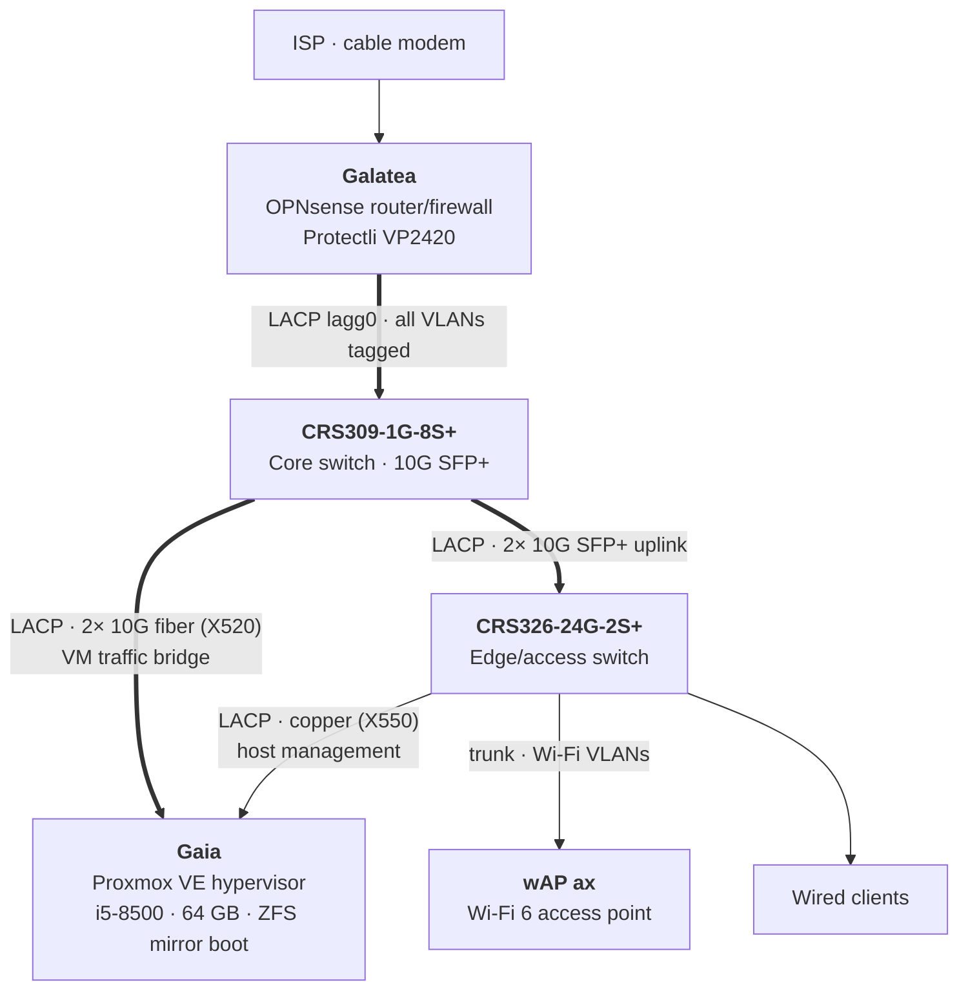
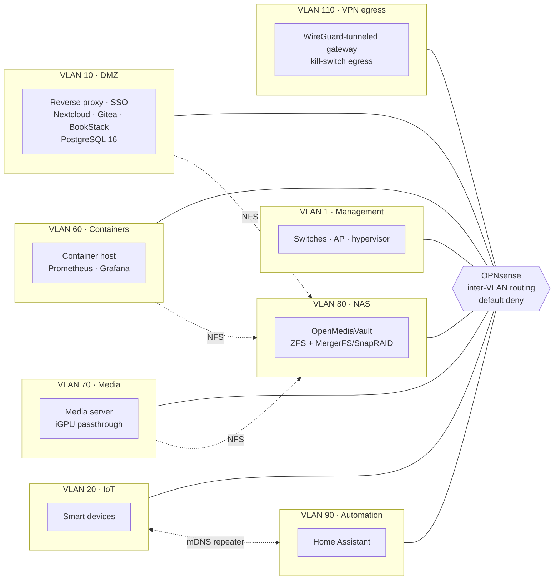

# Segmented Homelab Network Infrastructure

The lab runs an 11-VLAN network with OPNsense routing and firewalling over LACP trunks to a MikroTik 10G core, a Proxmox virtualization host with bonded fiber uplinks, tiered ZFS and SnapRAID storage, centralized SSO, and full-stack Prometheus/Grafana observability. Everything is self-hosted, documented, and version-controlled.

> All domains, credentials, and public addresses in this repository are sanitized. Internal domains appear as `lab.example`.

---

## Highlights

| Case study | Focus |
|---|---|
| | [Two devices answering for one gateway](case-studies/04-duplicate-gateway-arp.md) | Layer 2 troubleshooting, ARP, root-cause analysis |
| [Minimal-downtime VLAN migration of six VMs](case-studies/01-vlan-migration.md) | Change sequencing, rollback design |
| [Cross-VLAN NFS through a stateful firewall](case-studies/02-cross-vlan-nfs.md) | RPC port pinning, firewall alias design |
| [Docker bind mounts racing NFS at boot](case-studies/03-docker-nfs-race.md) | systemd ordering, silent failure modes |

---

## Physical topology



All inter-switch and router links are 802.3ad LACP bonds carrying every VLAN tagged. VM traffic rides the 10G fiber path to the core. Hypervisor management uses a separate copper bond to the edge switch, keeping it reachable even if the VM bridge is misconfigured.

---

## Logical segmentation



Additional VLANs: 30 (trusted users), 40 (guest), 50 (IP cameras, planned default-deny egress).

| VLAN | Name | Subnet | Purpose |
|---|---|---|---|
| 1 | Management | 192.168.1.0/24 | Network gear, hypervisor, out-of-band |
| 10 | DMZ | 192.168.10.0/24 | Internet-facing and shared services |
| 20 | IoT | 192.168.20.0/24 | Untrusted smart devices |
| 30 | Users | 192.168.30.0/24 | Trusted clients, Wi-Fi |
| 40 | Guest | 192.168.40.0/24 | Internet-only guest access |
| 50 | IP cameras | 192.168.50.0/24 | Cameras / NVR |
| 60 | Containers | 192.168.60.0/24 | Docker workloads, monitoring |
| 70 | Media | 192.168.70.0/24 | Media server, network tuner |
| 80 | NAS | 192.168.80.0/24 | Storage |
| 90 | Automation | 192.168.90.0/24 | Home Assistant |
| 110 | VPN egress | 192.168.110.0/24 | Tunneled egress |

---

## Design principles

- **Segmentation first.** Every workload class lives on its own VLAN; all inter-VLAN traffic crosses the firewall.
- **Named aliases, never raw IPs.** Every firewall rule references a named host or port-group alias, so rules stay readable and auditable.
- **Stage, verify, then cut over.** Old configuration is never removed until the replacement is confirmed working at each layer.
- **Snapshot before change.** Configs are exported and committed, and ZFS snapshots taken, before upgrades.
- **Document everything.** Every service and runbook is kept in a self-hosted wiki, updated after each work session.

---

## Platform stack

| Layer | Components |
|---|---|
| Routing & firewall | OPNsense (Unbound split-DNS, Kea/ISC DHCP, CrowdSec) |
| Switching & wireless | MikroTik RouterOS (bridge VLAN filtering, LACP), wAP ax |
| Virtualization | Proxmox VE 9, VLAN-aware bridges over bonded NICs, PCIe passthrough |
| Storage | OpenMediaVault 7, ZFS mirror (critical data), MergerFS + SnapRAID (bulk, 3 data + 1 parity) |
| Containers | Docker Compose, managed with Arcane across three hosts |
| Identity | Authentik SSO behind Nginx Proxy Manager |
| Observability | Prometheus with node, cAdvisor, Proxmox, and OPNsense exporters; Grafana dashboards |
| Backup | restic via Backrest; offsite replication of the cold tier with rclone |
| Docs & VCS | BookStack wiki, Gitea |

---

## Known limitations

- Local backups share a chassis with primary data; only the cold-tier dataset replicates offsite, so the setup is not yet full 3-2-1.
- DHCP is mid-migration from ISC to Kea; the cutover must move all scopes at once.

## Roadmap

- Alertmanager rules for filesystem capacity
- UPS integration with NUT (hypervisor as primary, firewall as client)
- Isolated NVR on the camera VLAN with default-deny egress
- Second access point with controller-managed roaming
- Throughput benchmarks across LACP bonds and through inter-VLAN routing

---

## Repository layout

```
diagrams/       Topology and segmentation diagrams
configs/        Sanitized MikroTik, OPNsense, Proxmox, and Docker configs
case-studies/   Technical write-ups
benchmarks/     Measurement methodology, raw data, and plots
```