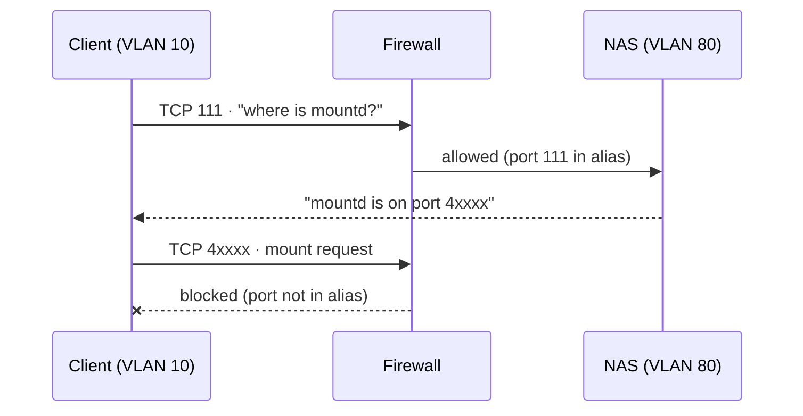

# Case Study 02: NFS Across a Strict Firewall Boundary

**Period:** June 2026
**Scope:** OPNsense firewall, OpenMediaVault NAS (VLAN 80), Docker host in the DMZ (VLAN 10)

## Summary

A web file manager in the DMZ needed to mount a document share from the NAS on another VLAN. The same NAS already served NFS to two other VLANs without any problems, but the DMZ mount hung. The cause was NFS's legacy RPC design: some of its services listen on ports assigned at runtime, and a firewall that allows only explicitly listed ports can't anticipate them. The fix was to pin those services to fixed ports and allow exactly those through the firewall.

## Context

| Role | Host | VLAN | Address |
|---|---|---|---|
| NFS server | NAS (OpenMediaVault) | 80 · Storage | 192.168.80.10 |
| NFS client | DMZ Docker host | 10 · DMZ | 192.168.10.254 |
| Router / firewall | OPNsense | all | `.1` on each VLAN |

The export was a dedicated ZFS dataset for documents, with its access list limited to the DMZ subnet. The DMZ is the most tightly controlled segment in the lab: traffic from it to any internal network is denied unless a rule allows that specific destination and those specific ports.

## Background: why NFS is hard to firewall

NFS predates stateful firewalls. In its v3-era design, several cooperating RPC services run alongside the main NFS daemon:

| Service | Purpose | Default port |
|---|---|---|
| portmapper (rpcbind) | Tells clients which port each service is on | 111 (fixed) |
| nfsd | File I/O | 2049 (fixed) |
| mountd | Export list and mount requests | **dynamic** |
| lockd / statd | File locking and crash recovery | **dynamic** |

A client first asks the portmapper on port 111 where `mountd` is listening, then connects to whatever port it's told. NFSv4 folds most of this into port 2049. However, tools like `showmount`, and some mount paths, still go through `mountd`.



## Investigation

**1. Observation.** The firewall alias `NFS_PORTS` allowed 111 and 2049. From the DMZ host, `showmount -e 192.168.80.10` hung instead of returning the export list.

**2. First hypothesis: `mountd` is blocked.** `showmount` depends on `mountd`. I added 20048, the conventional `mountd` port, to the alias. `showmount` still hung.

**3. Refined hypothesis: `mountd` isn't on 20048 at all.** The NAS's `/etc/nfs.conf` had the `mountd` port line commented out, so `mountd` was taking a dynamic port from the portmapper. Allowing 20048 opened a port nothing was listening on.

**4. The key comparison.** Two other VLANs (containers and media) already mounted NFS from the same NAS with no port pinning at all. Why did those work? Their firewall rules toward the NAS were broader and happened to cover whatever dynamic port `mountd` picked. The DMZ policy only allows ports listed explicitly. So the problem was never with NFS itself: it was the mismatch between a dynamic-port protocol and a firewall policy that allows only fixed ports.

## Resolution

I pinned the RPC services to fixed ports in `/etc/nfs.conf` on the NAS:

```ini
[mountd]
manage-gids=y
port=20048

[lockd]
port=32803
udp-port=32803
```

Then I restarted the NFS server and confirmed the new port:

```
systemctl restart nfs-server
rpcinfo -p | grep mountd      # should report 20048
```

The firewall alias was updated to exactly the pinned set: `NFS_PORTS = 111, 2049, 20048, 32803` (TCP and UDP). The DMZ rule allows that alias only toward the NAS's host alias, not toward the whole storage subnet.

**Verification from the client:**

```
showmount -e 192.168.80.10           # returns the export list
mount | grep nfs                     # mount is present
ls /mnt/nfs/temple/documents         # contents are readable
```

The mount was then made persistent in `/etc/fstab` with `_netdev`, so the system waits for the network before attempting it at boot.

## Results

- The DMZ host mounts the document share through a rule that allows four explicit ports to one explicit host.
- The NAS's NFS ports no longer change, so firewall rules written today will still match them after a reboot or upgrade.
- The same pinned alias now works for every client VLAN, so the broader rules on the other VLANs can be tightened to match.

## Limitations and follow-up experiments

- **The minimal port set wasn't tested.** A client forced to NFSv4.2 (`vers=4.2`) should need only port 2049. A planned experiment: mount with `vers=4.2`, take 111, 20048, and 32803 out of the alias one at a time, and record which operations fail. That would show empirically how much of the v3 RPC surface a v4-only deployment can drop.
- **Other VLANs are still broader than necessary.** The container and media VLANs worked because their rules were wider than required. Tightening them to `NFS_PORTS` is the next step.

## Lessons

1. **Ask why it works elsewhere.** The fastest diagnostic step was comparing the failing VLAN with the working ones. The difference pointed at firewall policy rather than NFS.
2. **Confirm the service before opening the port.** Allowing 20048 without checking `rpcinfo` opened a port nothing was listening on.
3. **Dynamic ports and explicit-allow firewalls don't mix.** Any protocol that negotiates ports at runtime has to be pinned before it can be firewalled precisely.
4. **Keep the alias and the server configuration in sync.** If `nfs.conf` and the firewall alias are updated separately, they drift apart. Both are now recorded in the runbook as a single change.
