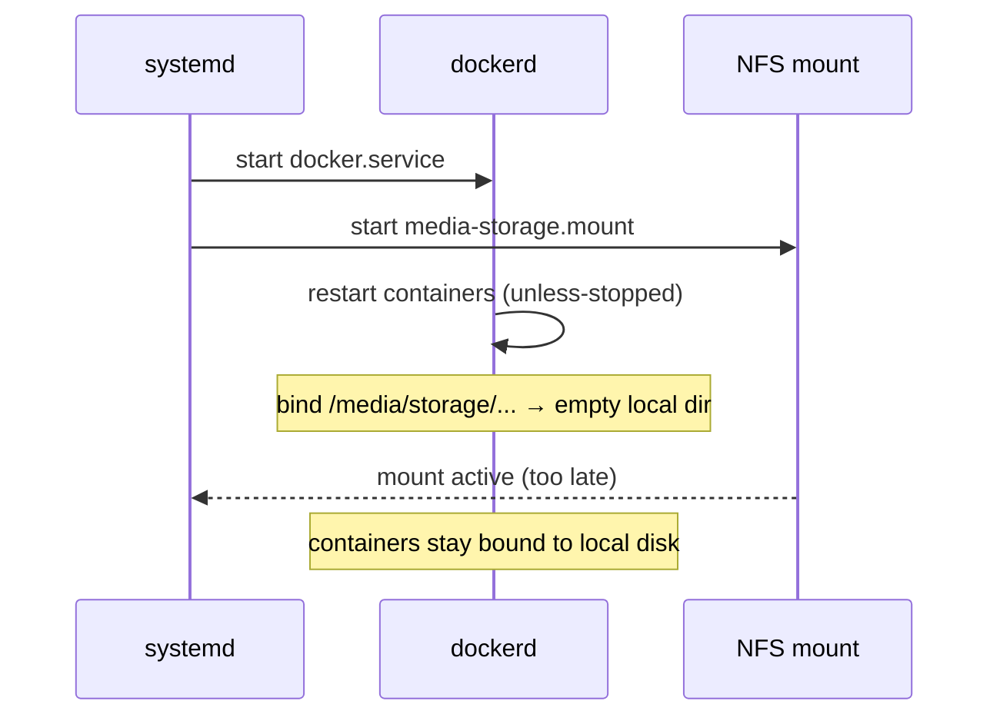

# Case Study 03: Containers That Looked Healthy but Saw Empty Disks

**Period:** September–October 2026
**Scope:** Docker hosts on VLANs 60 and 110, NAS on VLAN 80, systemd boot ordering

## Summary

An application container started failing to process files that clearly existed on the NAS. The host's network mount was healthy, the container reported "Up," and its volume paths were correct. Even so, the container was reading and writing a directory on the host's local root disk. The cause was a boot-time race: Docker started the container before the network share was mounted, and Docker bind mounts are fixed when a container is created. The immediate fix was to recreate the containers. The permanent fix was a systemd ordering dependency. During a later maintenance window, I found the permanent fix had been designed but never deployed on any host.

## Context

Three Docker hosts mount a large shared storage pool from the NAS at `/media/storage`, over NFS on one host and SMB on another, and bind subdirectories of it into containers:

```yaml
volumes:
  - /media/storage/app/incoming:/data/incoming
  - /media/storage/app/library:/data/library
```

Every container uses `restart: unless-stopped`.

## Investigation

**1. Observation.** A containerized application couldn't find a file it was supposed to process. The file was present on the NAS, and the host's mount was active.

**2. Rule out the obvious layers, in order:**

| Check | Command | Result |
|---|---|---|
| Is the share mounted on the host? | `findmnt /media/storage` | Yes, from the NAS |
| Is the file on the share? | `ls` on the host | Yes |
| Are the compose volume paths correct? | Review the compose file | Yes |
| Does `docker inspect` show the correct source? | `docker inspect <container>` | Yes |

Every layer looked correct, yet the container couldn't see the file.

**3. The decisive measurement.** I compared filesystem size from inside the container with the host:

```
docker exec <container> df -h /data/incoming
```

Inside the container, `/data/incoming` reported **47.9 GiB**, the size of the host's root disk. The NAS share is **33 TiB**. The container wasn't on the share at all.

**4. Mechanism.** A bind mount is resolved once, when the container is created, against whatever is at the source path at that moment. If `/media/storage` isn't mounted yet, the source path is just an empty directory on the root filesystem, and Docker binds to that. When the share is mounted afterward, it covers the mount point on the host, but the container keeps its existing binding to the empty local directory. `docker inspect` still shows the correct path string, because the problem is which directory got bound, not the path name.

**5. Why it happened at boot.** With `restart: unless-stopped`, the Docker daemon itself restarts containers as soon as it starts, before any management UI is involved. Nothing in the boot order made the daemon wait for network filesystems, so whether the container came up correctly depended on which finished first: Docker's startup or the network mount.



## Resolution

**Immediate:** recreate the affected containers once the mount is live. A plain `docker restart` isn't enough, because it reuses the existing container and its existing bindings.

**Permanent:** a systemd drop-in that makes the Docker daemon require the mount:

```ini
# /etc/systemd/system/docker.service.d/nfs-wait.conf
[Unit]
RequiresMountsFor=/media/storage
```

```
systemctl daemon-reload
systemctl show docker -p RequiresMountsFor      # should list /media/storage
```

`RequiresMountsFor=` adds both an ordering dependency (start after the mount) and a requirement (don't start without it).

### Design trade-off

With this dependency, if the NAS is unavailable at boot, Docker won't start at all on that host, including containers that don't use the share. I accepted this deliberately. A host with no containers running fails **loudly** and gets noticed right away. Containers writing to the root disk fail **silently** and can fill that disk or scatter data in the wrong place without anyone noticing.

## The second finding: designed but not deployed

The drop-in was specified in September, when the race was first diagnosed. In October, before rebooting the Docker hosts for a hypervisor upgrade, I checked each host:

```
systemctl cat docker | grep -i RequiresMountsFor
```

The check came back empty on **every** host. The fix had been documented but never applied. One host had already been rebooted without it, and it happened to win the race that time. The drop-in was then applied to each host before any further reboots.

## Limitations and follow-up experiments

- **Race frequency wasn't measured.** A planned experiment: reboot a test VM N times without the drop-in, record whether each boot binds the share or the empty directory, and estimate the race probability. Repeat with the drop-in to confirm the result goes to zero.
- **No automated detection yet.** A container health check that compares `df` on its data path against an expected minimum size would turn this silent failure into an alert.

## Lessons

1. **"Running" isn't the same as "correct."** Status checks confirmed every component was up. Only a measurement of what the container actually saw (`df` showing the filesystem size) exposed the fault.
2. **Know when a resource is bound.** Bind mounts, DNS lookups, and file handles all fix their target at some point in time. Debugging means knowing when that point is.
3. **Prefer loud failures to silent ones.** I chose the dependency that can stop Docker entirely, because a visible outage is safer than undetected misplaced writes.
4. **Audit fixes, don't assume them.** Writing down a fix doesn't put it in place. Checking the live configuration on every host before a risky change found the gap.
