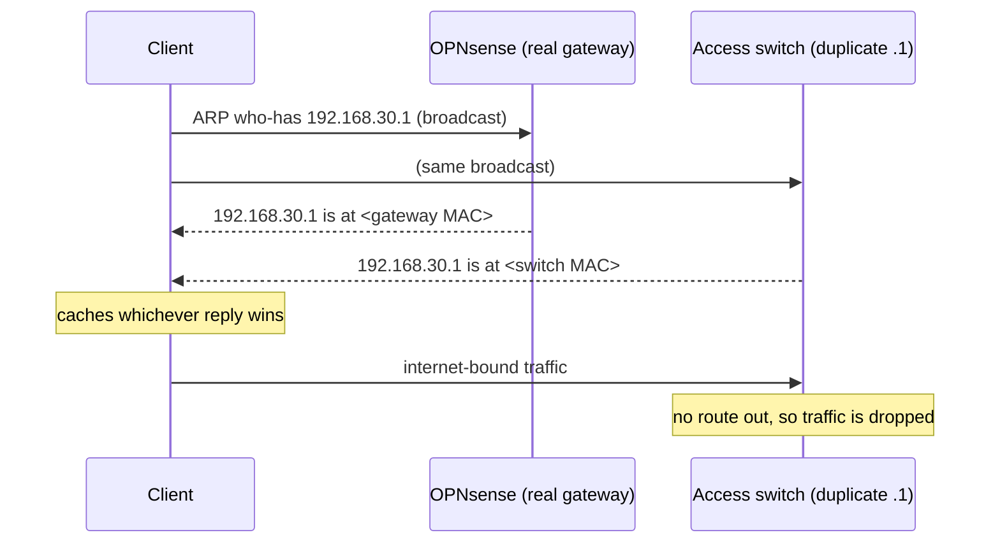

# Case Study 04: Two Devices Answering for One Gateway

**Period:** August 2026
**Scope:** User VLAN (30), OPNsense gateway, MikroTik CRS326 access switch, wAP ax access point

## Summary

Clients on the user Wi-Fi VLAN intermittently lost internet access. Some devices failed and others on the same network worked fine, and every configuration I reviewed was correct. The cause was a stray IP address on the access switch: it held the VLAN's gateway address, so two devices answered ARP for the gateway. Each client cached whichever reply reached it first. Clients that cached the switch's reply sent their traffic to a device with no route to the internet. Removing the duplicate address fixed it right away.

## Context

| Role | Device | Expected gateway behavior |
|---|---|---|
| Gateway for VLAN 30 | OPNsense (`192.168.30.1`) | The only device that should answer ARP for `.1` |
| Access switch | MikroTik CRS326 | Pure layer 2: forward frames, hold no addresses on client VLANs |
| Access point | MikroTik wAP ax | Bridges Wi-Fi clients onto VLAN 30 |

## Symptoms

- Packet loss to the internet of roughly 50% from affected clients, with "destination host unreachable" responses.
- **Per-client variance:** on the same SSID at the same time, some devices worked and others didn't.
- Affected clients could still reach other local devices, which made it look like a routing or upstream problem rather than a local one.
- Every reviewed configuration was correct: the gateway's interface and rules, the access point's VLAN mapping, and the core switch's trunk tagging.

## Investigation

**1. The early approach checked each component's configuration.** I reviewed the gateway, the access point, and the core switch in turn. All were configured correctly. The time spent here was the costliest part of the incident, because the fault wasn't in any configuration I was reviewing. It was on a device I'd assumed was pure layer 2.

**2. Comparing what clients saw with what they should see.** On an affected Windows client:

```
arp -a
```

The ARP entry for `192.168.30.1` showed a MAC address that wasn't the gateway's. The client was sending its internet-bound traffic to the wrong device.

**3. Identifying the owner of that MAC.** I searched for the unknown MAC in the bridge host tables:

```
/interface/bridge/host/print where mac-address=<unknown MAC>
```

On the CRS326, the entries carried the `L` (local) flag. **The MAC belonged to the switch itself.** An access switch was answering ARP for a gateway address it had no reason to own.

**4. Finding why.** I listed the switch's addresses:

```
/ip/address/print
```

| Address | Interface | Expected? |
|---|---|---|
| `192.168.1.3/24` | management | Yes, the switch's management IP |
| `192.168.30.1/24` | `vlan30` | **No. This duplicates the VLAN 30 gateway.** |
| `192.168.88.2/24` | bridge | No, a leftover from the vendor default range |

The switch held the VLAN 30 gateway address on a VLAN interface, so it answered ARP for it, just as any host owning that address would.

## Mechanism



ARP has no authority model: a client accepts any reply it receives, and the cached result determines where it sends traffic until the entry expires. With two responders, each client's outcome depended on which reply arrived first, which explains the per-client variance. When entries expired and were re-resolved, a client could switch between working and failing, which made the problem intermittent.

## Resolution

I removed the duplicate address on the switch:

```
/ip/address/remove [find address="192.168.30.1/24"]
```

Then I flushed the poisoned ARP cache on the affected client (from an administrator shell):

```
arp -d *
arp -a       # gateway now resolves to the gateway's MAC
ping 1.1.1.1 # internet reachable
```

Other clients recovered as their ARP entries expired, or right away after reconnecting to Wi-Fi.

The leftover `192.168.88.2/24` address was removed in a later session. At that point the switch's only IP address was its management address.

## Results

- Internet access was restored for every VLAN 30 client.
- A pure layer 2 switch now holds a single management address, on the management VLAN only.

## Limitations

- **The duplicate address's origin wasn't determined.** It was most likely left over from earlier configuration of the switch, but I didn't establish that.
- **The impact wasn't quantified.** I didn't record the share of affected clients or how long the outage lasted, beyond the rough 50% loss figure observed during troubleshooting.
- **There's no detection in place yet.** An ARP monitor alerting on any MAC change for a gateway address (for example, `arpwatch` on the router or a scheduled check against the expected gateway MAC) would catch this, or a deliberate ARP spoofing attack, within minutes.

## Lessons

1. **When configs are correct but behavior is wrong, check what's on the wire.** One `arp -a` comparing the observed gateway MAC with the expected one would have pointed at the fault within minutes.
2. **"Pure layer 2" is a claim to verify, not assume.** A switch with a stray IP address on a client VLAN acts like a host on that network. Auditing addresses on every infrastructure device (`/ip/address/print`) takes seconds.
3. **Per-client variance points to client-side state.** When identical clients on the same network behave differently, look at what each one has cached: ARP, DNS, or DHCP leases.
4. **Duplicate addresses are indistinguishable from spoofing.** This was an accident, but the symptoms and the detection method are the same as for a deliberate ARP spoofing attack. That's why gateway MAC monitoring is worth having.
